# TeX Side Preview

**Overleaf-style LaTeX editing inside VS Code.** Your source is on the left and the PDF on the right. Save the file and the PDF re-renders in place. Double-click the PDF to jump to the source, links work, text can be copied, and the project can sync both ways with Overleaf.

It feels like part of VS Code rather than something bolted on. The LaTeX help works through VS Code's own features: suggestions, hovers, Outline, folding, Format Document, the Problems panel, Expand Selection and the status bar. The only addition is a **Symbols** palette in the bottom panel, which appears only while a LaTeX file is open.

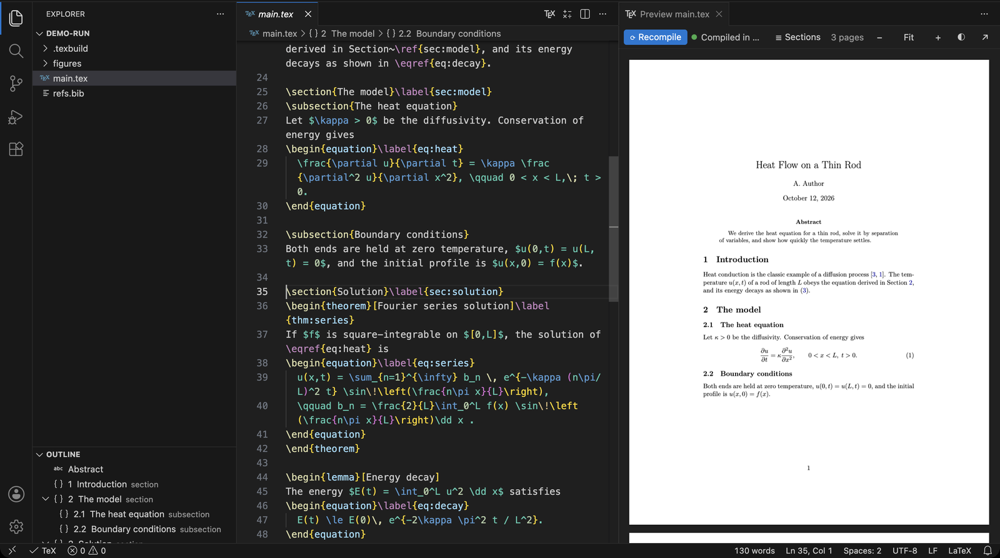

**Contents**

- [Features at a glance](#features-at-a-glance)
- [Complete feature list](#complete-feature-list)
- [Installation](#installation)
- [Opening the preview](#opening-the-preview)
- [Features](#features)
  - [Live preview on save](#live-preview-on-save)
  - [Errors and warnings](#errors-and-warnings)
  - [PDF → source: double-click to jump](#pdf--source-double-click-to-jump)
  - [Source → PDF: jump to location](#source--pdf-jump-to-location)
  - [Clickable links](#clickable-links)
  - [Selecting and copying text](#selecting-and-copying-text)
  - [Zoom](#zoom)
  - [Multi-file projects](#multi-file-projects)
- [Writing LaTeX](#writing-latex)
- [Viewing the PDF](#viewing-the-pdf)
- [Build options](#build-options)
- [Supported files](#supported-files)
- [Comments and tracked changes](#comments-and-tracked-changes)
- [Overleaf sync](#overleaf-sync)
- [Commands and keyboard shortcuts](#commands-and-keyboard-shortcuts)
- [Settings](#settings)
- [Troubleshooting](#troubleshooting)
- [Building from source](#building-from-source)

---

## Features at a glance

| | |
|---|---|
| 🖥️ **Side-by-side preview** | The PDF opens next to your source, the way Overleaf shows it. |
| 💾 **Recompile on save** | Press ⌘S and the PDF refreshes, keeping your scroll position. |
| 🧭 **SyncTeX, both directions** | Double-click the PDF to jump to the source line, or press ⌘⌥J to jump from the source into the PDF. |
| 🔗 **Working links** | `\ref`, `\cite`, contents and footnote links scroll inside the PDF; URLs open in your browser. |
| ✂️ **Select and copy** | Drag across text in the PDF and press ⌘C. |
| 🚨 **Clickable errors** | Errors are listed above the PDF and in the Problems panel; the last good PDF stays visible. |
| ☁️ **Two-way Overleaf sync** | Saves are pushed, Overleaf changes are pulled, and conflicts open in VS Code's merge editor. |
| 💡 **Suggestions** | `\cite` keys from your `.bib` files, `\ref` labels, commands, environments, file paths and packages. |
| 🔍 **Hover previews** | Rendered math, citation details, referenced equations, figures and package links. |
| 🗂️ **Outline and folding** | Sections, figures and tables in the Outline view and breadcrumbs; fold sections and environments. |
| ✍️ **Editing helpers** | Bold or italicise the selection, wrap it in an environment, continue `\item` lists, close environments. |
| 🧹 **Format and lint** | Format Document for `.tex` and `.bib`, warnings for duplicate labels, optional ChkTeX. |
| 🔣 **Symbol palette** | Click to insert Greek letters, relations, arrows, accents, matrices, figures and tables. |
| 🌐 **Preview in the browser** | The same live preview in a browser tab, still synced with the editor. |
| 🔢 **Word count** | Words in the status bar; characters and per-file counts one click away. |
| 💬 **Comments and tracked changes** | Review together like on Overleaf, with no markup added to your LaTeX; shared through the Overleaf or Git sync. |

---

## Complete feature list

**Preview and build**
- Side-by-side PDF preview that rebuilds when you save `.tex`, `.bib`, `.sty`, `.cls`, `.rnw` or `.jnw` files, keeping your place.
- Live preview in a browser tab (↗ in the preview), PDF in your external viewer, and a dark-PDF toggle (◐).
- **Sections** menu in the preview: the document's numbered headings; pick one to scroll there.
- SyncTeX both ways: double-click the PDF to reach the source; ⌥⌘J / Ctrl+Alt+J to reach the PDF.
- Clickable links in the PDF, text selection and copy, zoom (buttons, Fit, ⌘/Ctrl + wheel).
- Errors listed above the PDF and in the Problems panel; the last good PDF stays visible.
- latexmk, tectonic, pdflatex, xelatex or lualatex (with BibTeX); your own build command; Docker; knitr/Weave.
- Stop a compile, clean auxiliary files, show the full log; **TeX** status bar menu for all of these.
- Main file found automatically (or via `% !TEX root`); `\input`, `\include`, `\subfile` and `\import` followed.
- Two-way Overleaf sync over Git, with conflicts resolved in VS Code's merge editor.

**Reviewing together**
- Comment threads on any selection, with replies, editing, resolve and reopen, in VS Code's own Comments UI.
- Track Changes: your edits become suggestions (insertions highlighted, deletions shown struck through); anyone can accept or reject them, one at a time or all at once.
- Nothing is added to the LaTeX: review data lives in `.texreview/`, one file per person, and travels with the project through the Overleaf or Git sync.

**Writing**
- Suggestions for `\cite` (from `.bib` files and `thebibliography`, searchable by author or title), `\ref` (with printed numbers), 220+ commands with their symbols, your own macros, environments with the matching `\end`, file paths and packages.
- `@` shortcuts (`@a` → `\alpha`, `@/` → `\frac`, `@R` → `ℝ` …) and uppercase shortcuts (`BEQ` → equation, `FBF` → `\textbf` …).
- Hover previews: rendered math with your macros; citation details; referenced equations, captions and sections; figure thumbnails (PDF figures too); package and command help with the symbol's glyph.
- Symbols palette (⌃L P) and **Insert Symbol…** (⌃L .) with recent symbols and search; math symbols get `$…$` outside math, and a selection becomes the first argument.
- One-key formatting: bold, italic, emphasis, typewriter, underline, small caps, footnote, inline math (press again to remove; math variants inside math).
- Surround with any command or environment; close the open environment; toggle `\[ \]` ⇄ `equation*`; toggle `*` on headings and environments; promote/demote headings; jump between `\begin` and `\end`.
- `\item` lists continue on Enter; Enter on an empty `\item` leaves the list.
- **LaTeX** submenu in the editor's right-click menu with all of the above.

**Navigating and checking**
- Outline, breadcrumbs and Go to Symbol with numbered headings (1, 1.2, A for appendices) across all files, plus figures, tables, theorems, frames, abstract and references.
- Folding for sections, environments, comment blocks and `% region` markers; Expand Selection through math and environments; linked `\begin`/`\end` renaming.
- Word count in the status bar (and for the selection); details with characters, formulas and a per-file breakdown.
- Format Document for `.tex` (latexindent or built-in) and `.bib`; duplicate-label warnings; optional ChkTeX linting.
- Works in Remote SSH, WSL and Dev Containers.

---

## Installation

### 1. Install a LaTeX compiler

The extension runs your local LaTeX installation and uses the first compiler it finds:

| Compiler | Install on macOS | Notes |
|---|---|---|
| `latexmk` | `brew install --cask mactex-no-gui` | Full TeX Live. The fastest choice for repeated builds; handles BibTeX/Biber. |
| `tectonic` | `brew install tectonic` | A small single binary that downloads packages on first use (the first compile takes a few minutes, later ones a few seconds). |
| `pdflatex` | comes with TeX Live / MiKTeX | Fallback. Runs BibTeX and reruns as needed. |

On Linux, `sudo apt install texlive-full latexmk` works. On Windows, install MiKTeX or TeX Live. The extension also looks in the usual install folders (`/Library/TeX/texbin`, `/opt/homebrew/bin`, `/usr/local/texlive/*/bin/*`, …), so it works even when VS Code is started from the Dock.

### 2. Install the extension

In VS Code, open the **Extensions** view (⇧⌘X / Ctrl+Shift+X), search for **TeX Side Preview**, and click **Install**.


Other ways to install:

- **Quick Open:** press ⌘P (Ctrl+P), paste `ext install HemantBanke.tex-side-preview` and press Enter.
- **Command line:** run `code --install-extension HemantBanke.tex-side-preview`.
- **Cursor, VSCodium, Windsurf:** search for **TeX Side Preview** in their Extensions view; it's published on [Open VSX](https://open-vsx.org/extension/HemantBanke/tex-side-preview).
- **From a `.vsix` file:** in the Extensions view, open the **`···`** menu → **Install from VSIX…** and pick the file.

  

---

## Opening the preview

Open any `.tex` file, then use whichever way suits you.

**Editor title bar.** Click the **T<sub>E</sub>X** button at the top right of the editor, next to *Split Editor*:


**Right-click the file in the Explorer.** Choose **Open TeX Preview to the Side**:


**Right-click inside the editor.** The menu offers **Open TeX Preview to the Side** and **Jump to Location in PDF**:


**Right-click the editor tab.** Choose **Open TeX Preview to the Side**:


**Keyboard.** Press **⌥⌘V** (Ctrl+Alt+V on Windows/Linux), or run **TeX: Open TeX Preview to the Side** from the Command Palette.

---

## Features

### Live preview on save

Edit, press **⌘S**, and the PDF recompiles and refreshes in place without losing your scroll position. **⌘↵** (Ctrl+Enter) saves and recompiles in one step, and the **Recompile** button in the preview does the same. The status line shows how long the compile took and how many warnings it produced. The status bar shows the state too: **✓ TeX**, a spinner while compiling, or **TeX: errors**.

Saving any `.tex`, `.bib`, `.sty` or `.cls` file in the project triggers a recompile.

### Errors and warnings

If a compile fails, the errors are listed above the PDF. **Click one to jump to that line.** The preview keeps showing the last good PDF until the error is fixed. Errors and warnings also appear in the **Problems** panel and as squiggles in the editor. **Show full log** opens the complete compiler output.


### PDF → source: double-click to jump

**Double-click any word in the PDF.** The editor jumps to the line that produced it and selects that word, the same as Overleaf. This uses SyncTeX, so it works for paragraphs, headings, captions and math.


### Source → PDF: jump to location

Put the cursor on a line and press **⌥⌘J** (Ctrl+Alt+J), or right-click → **Jump to Location in PDF**. The preview scrolls to that spot and then highlights the typeset line for a couple of seconds:


### Clickable links

Hyperlinks in the PDF work like in a PDF viewer. `\ref`, `\eqref`, `\cite`, table-of-contents and footnote links scroll to their target inside the preview, and `\url`/`\href` links open in your browser. Hovering a link outlines it.


### Selecting and copying text

Drag across text in the PDF to select it, then press **⌘C** (Ctrl+C) to copy it, line breaks included.


### Zoom

Use **−** and **+** in the preview's toolbar, or hold ⌘/Ctrl and scroll the mouse wheel. **Fit** (or the percentage label) fits the page to the panel width and follows the panel as you resize it.


### Multi-file projects

For projects split across files with `\input` or `\include`, add a magic comment at the top of each included file pointing to the main file:

```latex
% !TEX root = ../main.tex
```

Opening the preview from any of those files then shows the main document, and saving any file in the project recompiles it.

---

## Writing LaTeX

All of this works in `.tex` files with no setup, and it reads the whole project: the main file and everything it `\input`s or `\include`s.

### Suggestions

- **`\cite{`** suggests keys from the `.bib` files named in `\bibliography` or `\addbibresource`, and from a `thebibliography` block. You can type part of an author's name or the title to find the key.
- **`\ref{`**, `\eqref{`, `\cref{` and similar suggest your labels. After a latexmk or pdflatex compile, the printed number is shown next to each one.
- **`\`** suggests more than 220 commands, showing each symbol's glyph next to it (`\alpha  α`, `\Rightarrow  ⇒`), plus the macros defined with `\newcommand` in your project.
- **`\begin{`** suggests environments and inserts the matching `\end`. **`\end{`** suggests the environment that is still open.
- **`\includegraphics{`**, **`\input{`** and **`\bibliography{`** suggest files and folders from the project.
- **`\usepackage{`** suggests common packages.

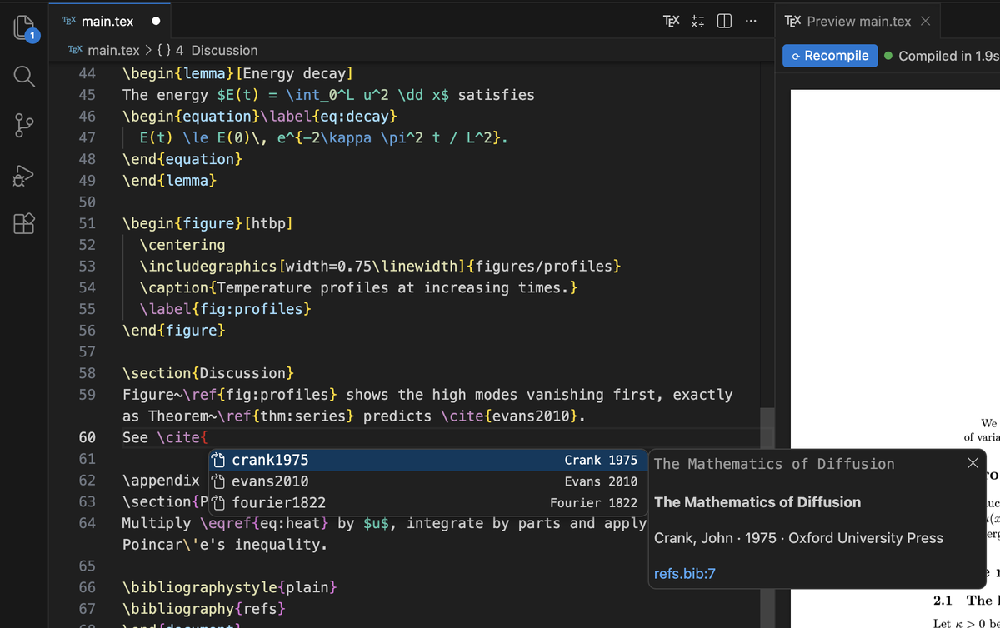 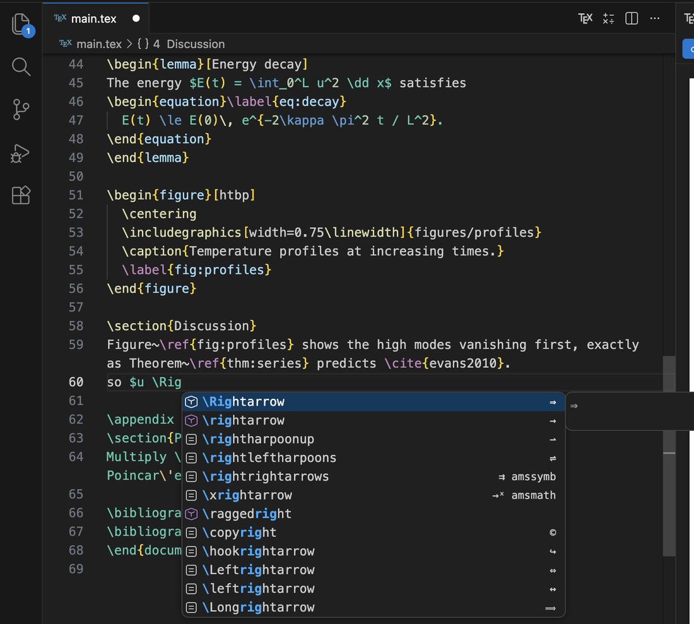

**Shortcuts**, offered as suggestions:

| Type | Get |
|---|---|
| `@a` … `@z`, `@D`, `@G`, `@L` … | Greek letters: `\alpha`, `\Delta`, `\Gamma`, `\Lambda` … (`@ve` gives `\varepsilon`, `@vf` gives `\varphi`) |
| `@/` `@%` `@2` `@3` | `\frac{}{}`, `\frac{\partial}{\partial}`, `\sqrt{}`, `\sqrt[3]{}` |
| `@(` `@[` `@{` `@\|` | `\left( \right)` and the other auto-sized delimiters |
| `@I` `@N` `@T` | `\int_{}^{}`, `\sum_{}^{}`, `\prod_{}^{}` |
| `@R` `@C` `@Z` `@E` | `\mathbb{R}`, `\mathbb{C}`, `\mathbb{Z}`, `\mathbb{E}` |
| `@<` `@>` `@!` `@=` `@8` `@6` `@0` | `\leq`, `\geq`, `\neq`, `\equiv`, `\infty`, `\partial`, `\emptyset` |
| `@^` `@_` `@~` `@.` `@:` | `\hat{}`, `\bar{}`, `\tilde{}`, `\dot{}`, `\ddot{}` |
| `@*` `@+` `@-` `@@` `@;` `@,` | `\times`, `\cup`, `\cap`, `\circ`, `\mid`, `\nonumber` |
| `BEQ` `BAL` `BGA` `BMU` `BIT` `BEN` `BFI` `BTA` `BTB` `BPM` `BCAS` … | `\begin{equation}`, `align`, `gather`, `multline`, `itemize`, `enumerate`, `figure`, `table`, `tabular`, `pmatrix`, `cases` … (`BS…` gives the starred form, e.g. `BSEQ` → `equation*`) |
| `FBF` `FIT` `FEM` `FTT` `FSC` `FSF` `FUL` | `\textbf{}`, `\textit{}`, `\emph{}`, `\texttt{}`, `\textsc{}`, `\textsf{}`, `\underline{}` |
| `MBB` `MCA` `MBF` `MRM` `MFR` `MSC` `MBS` | `\mathbb{}`, `\mathcal{}`, `\mathbf{}`, `\mathrm{}`, `\mathfrak{}`, `\mathscr{}`, `\boldsymbol{}` |

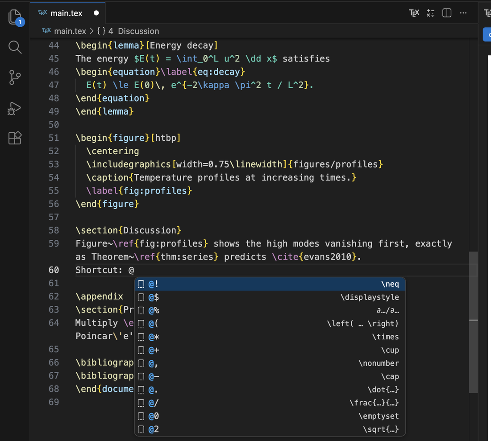

### Symbol palette

Click the **∑-style operator icon** in the editor's title bar (next to the T<sub>E</sub>X preview button), press ⌃L P / Alt+L P, or pick **Show Symbol Palette** from the **TeX** status bar menu. The palette opens as a **LaTeX Symbols** tab in the bottom panel; drag the tab to the sidebar if you prefer it there. **TeX: Insert Symbol…** (⌃L . / Alt+L .) for the same list in a searchable picker. There are ten groups: Greek, Structures (fractions, roots, sums, delimiters, matrices, cases), Accents, Fonts, Relations, Operators, Arrows, Misc, Text and Blocks (figure, table, lists, equations, theorem, proof, frame). Search by name ("arrow", "matrix", "norm"); the symbols you used last appear at the top.

Click a symbol to insert it at the cursor:
- A math symbol inserted outside math is wrapped in `$…$` (matrices and cases in `\[…\]`).
- If text is selected, it becomes the first argument: select `x+1` and click the fraction to get `\frac{x+1}{}`.

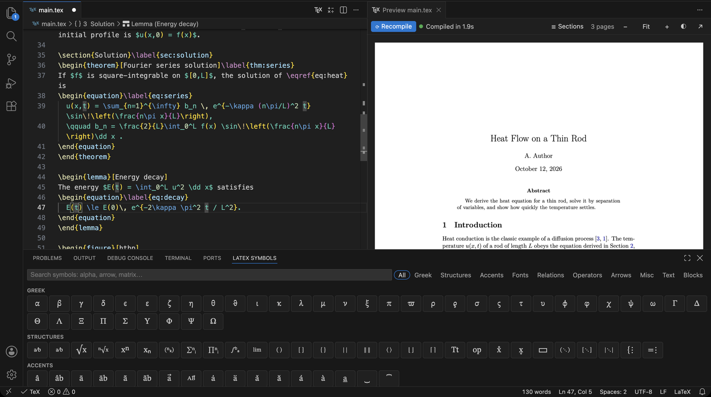

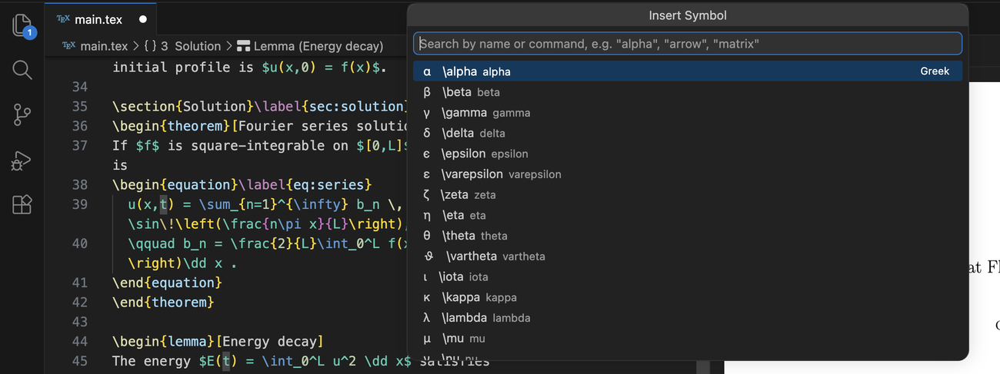

### Hover previews

Hover over:

- **math** (`$…$`, `\[…\]`, `equation`, `align`, …) to see it rendered, with your own `\newcommand` macros;
- **a citation key** for the title, authors, year and venue, with a link to the entry;
- **a reference** for what it points to: the rendered equation, the figure or table caption, or the section;
- **an `\includegraphics` path** for a thumbnail (PNG, JPG, SVG, and PDF/EPS through Ghostscript or, on macOS, the built-in `sips`);
- **a package name** for a link to its CTAN documentation, and **a command** for its symbol and a one-line description.

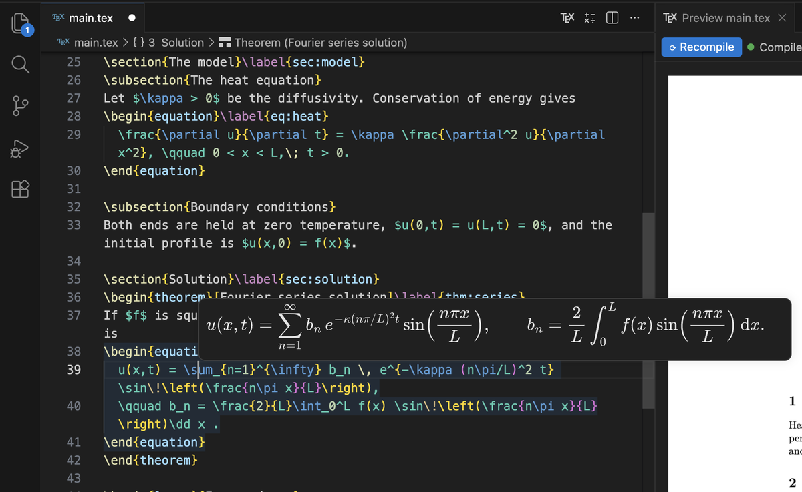 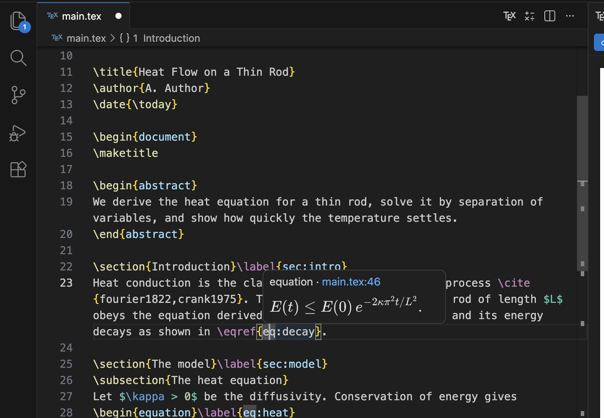
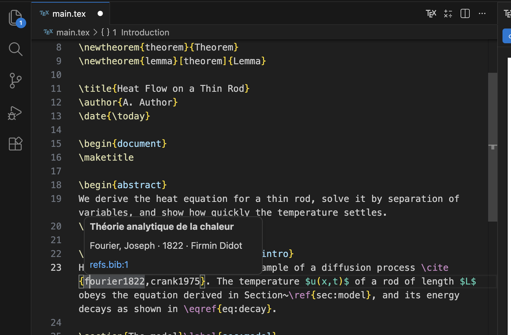 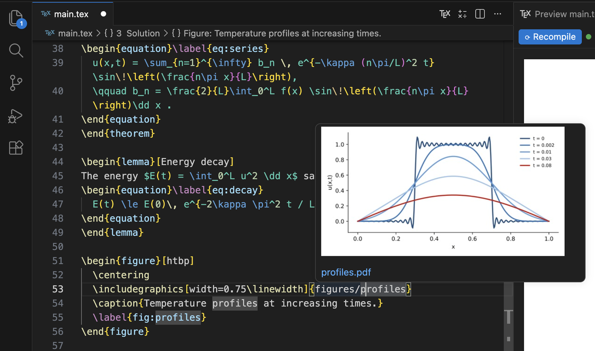

### Outline, folding and selection

- The **Outline** view, breadcrumbs and **Go to Symbol** (⇧⌘O) show the document as it will be numbered: `1 Introduction`, `2.3 Results`, `A Proofs` after `\appendix`. Numbers are counted across the whole project, so an included chapter file shows its real numbers. Headings are shown without LaTeX markup.
- Also listed: figures and tables (with their captions), theorems, lemmas and definitions (with their optional titles, and your own `\newtheorem`s), Beamer frames, the abstract and the references.

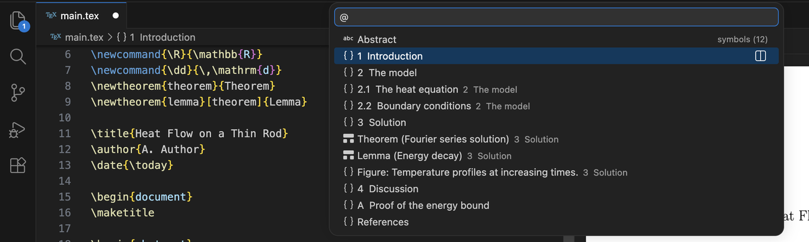
- **Folding** works on sections, environments, runs of comments and `% region` / `% endregion` markers.
- **Expand Selection** (⌃⇧⌘→ / Shift+Alt+→) grows from a word to the math or environment contents, then to the whole environment.
- With `"editor.linkedEditing": true`, renaming `\begin{foo}` renames its `\end{foo}` too.

### Editing helpers

All of these work with several cursors. They use ⌃L on macOS and Alt+L on Windows/Linux, then a key, so VS Code's own ⌘L / Ctrl+L stays as it is.

**Right-click** for the same actions. The menu only offers what applies where you clicked:
- **LaTeX → Format** and **Surround with…** are always there.
- **LaTeX → Structure** has *Promote/Demote Heading* on a heading, and *Toggle Star* on a heading or in `equation`, `align`, `figure`, `table`… It offers *Toggle `\[ \]` and `equation*`* in display math, and *Close Current Environment* and *Go to Matching `\begin`/`\end`* inside an environment. The submenu is hidden when none of these apply.
- **Accept Change** and **Reject Change** appear at the top of the menu on a tracked change, and **Add Comment** when text is selected.
- **LaTeX → Review** shows *Track Changes* with a checkmark when it's on, and *Accept/Reject All* and *Next/Previous Change* only when the file has changes.

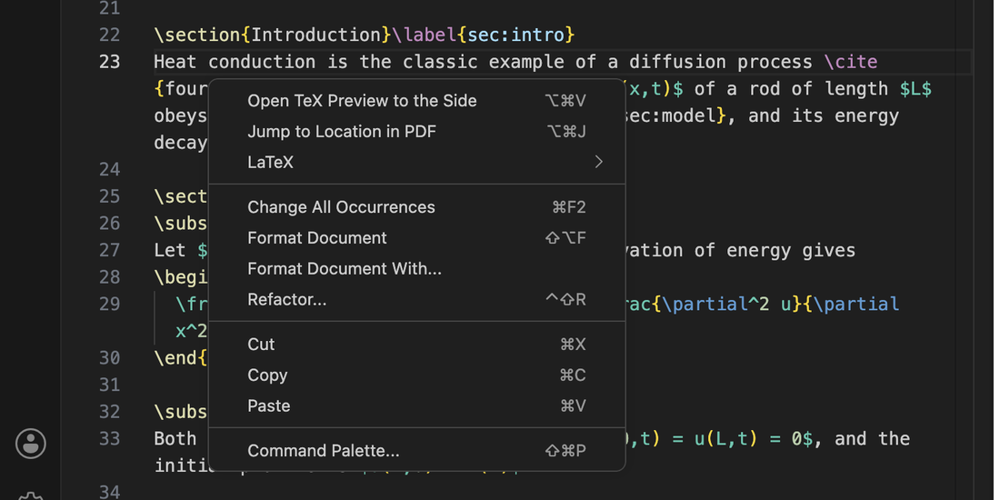

| Action | macOS | Windows / Linux |
|---|---|---|
| Bold: `\textbf`, or `\mathbf` in math (press again to remove) | ⌃L B | Alt+L B |
| Italic: `\textit` / `\mathit` | ⌃L I | Alt+L I |
| Emphasis: `\emph` | ⌃L E | Alt+L E |
| Typewriter: `\texttt` / `\mathtt` | ⌃L T | Alt+L T |
| Underline | ⌃L U | Alt+L U |
| Small caps: `\textsc` | ⌃L S | Alt+L S |
| Footnote around the selection | ⌃L F | Alt+L F |
| Inline math `$…$` (press again to remove) | ⌃L 4 | Alt+L 4 |
| Surround with a command… (40 common ones, or any) | ⌃L W | Alt+L W |
| Surround with an environment… | ⌃L N | Alt+L N |
| Close the current environment | ⌃L C | Alt+L C |
| Toggle `\[ … \]` and `equation*` | ⌃L M | Alt+L M |
| Toggle `*`: `\section` ⇄ `\section*`, `equation` ⇄ `equation*` | ⌃L 8 | Alt+L 8 |
| Promote heading (`\subsection` → `\section`) | ⌃L ↑ | Alt+L ↑ |
| Demote heading (`\section` → `\subsection`) | ⌃L ↓ | Alt+L ↓ |
| Jump between `\begin` and `\end` | ⌃L J | Alt+L J |
| Insert Symbol… | ⌃L . | Alt+L . |
| Show the Symbols palette | ⌃L P | Alt+L P |
| Word count details | ⌃L ⌃C | Alt+L Alt+C |

**Lists:** pressing Enter at the end of an `\item` line starts the next `\item`. Pressing Enter on an empty `\item` removes it and steps out of the list.

**Word count:** the status bar shows the project's word count while a LaTeX file is open, or *"120 of 8,314 words"* when text is selected. Click it for characters (with and without spaces), the number of formulas and a count for each file. Math, commands and comments aren't counted as words.

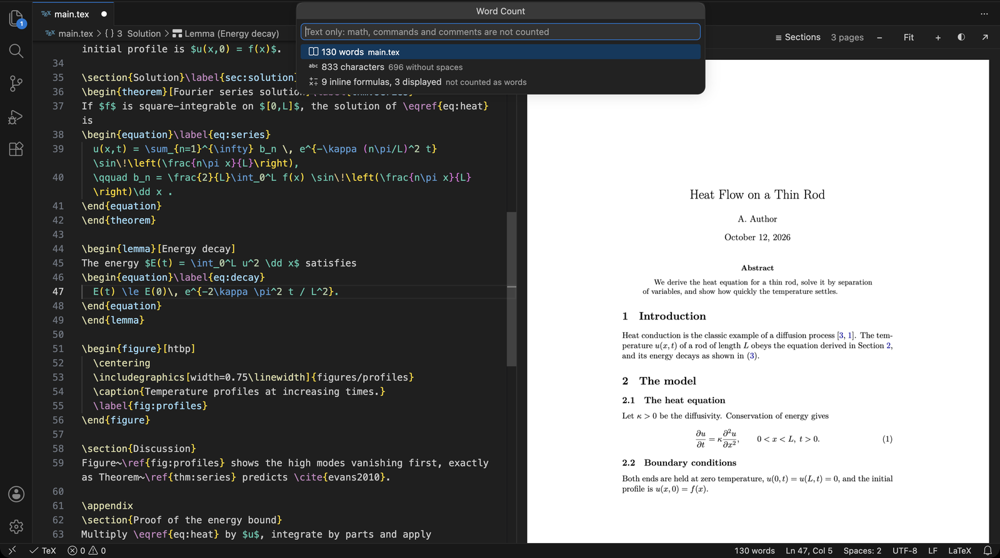

### Formatting and linting

- **Format Document** (⇧⌥F) re-indents `.tex` files by environment, using `latexindent` if it's installed. In `.bib` files it puts one field per line, aligns the `=` signs and leaves a blank line between entries.
- **Duplicate labels** are flagged in the Problems panel as you type, across all the project's files.
- **ChkTeX:** set `texPreview.chktex` to `true` to lint as you type (ChkTeX comes with TeX Live).

---

## Viewing the PDF

| Where | How |
|---|---|
| **Beside the editor** | The **T<sub>E</sub>X** button, ⌥⌘V / Ctrl+Alt+V, or any of the right-click menus. |
| **In a web browser** | **↗** in the preview's toolbar, **TeX: Open Preview in Browser**, or the **TeX** status bar menu. It's the same viewer, updated live after each compile. Double-click jumps to VS Code, ⌥⌘J scrolls the browser, and the Sections menu works. It's served from your machine only (`127.0.0.1`, with a private link), and forwarded automatically in remote sessions. |
| **In another PDF app** | **TeX: Open PDF in External Viewer** opens the system's PDF app, or the command in `texPreview.externalViewer.command`. The PDF is still rebuilt on save. **Jump to Location in PDF** runs `texPreview.externalViewer.syncCommand` (for example Skim's `displayline`). For inverse search, set the viewer to run `code -g %file:%line`. |

In the preview toolbar:
- **☰ Sections** lists the numbered headings; pick one to scroll there.
- **◐** shows the PDF with dark pages. `texPreview.invertPdf` sets the default.
- **−**, **Fit** and **+** zoom.

The **TeX** item in the status bar (shown for LaTeX files) opens a menu: Recompile, Stop, Open Preview, Open in Browser, Open in External Viewer, Jump to Location, Word Count, Insert Symbol, Clean, Show Log.

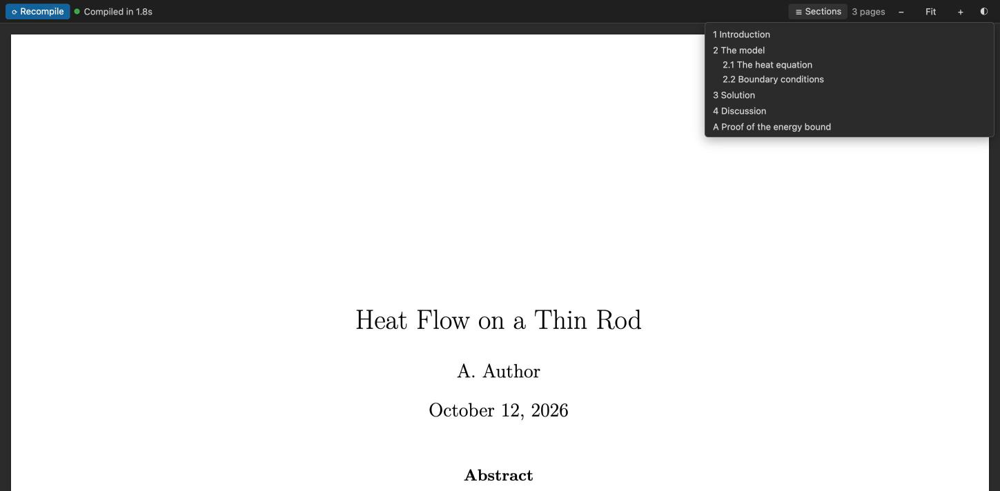

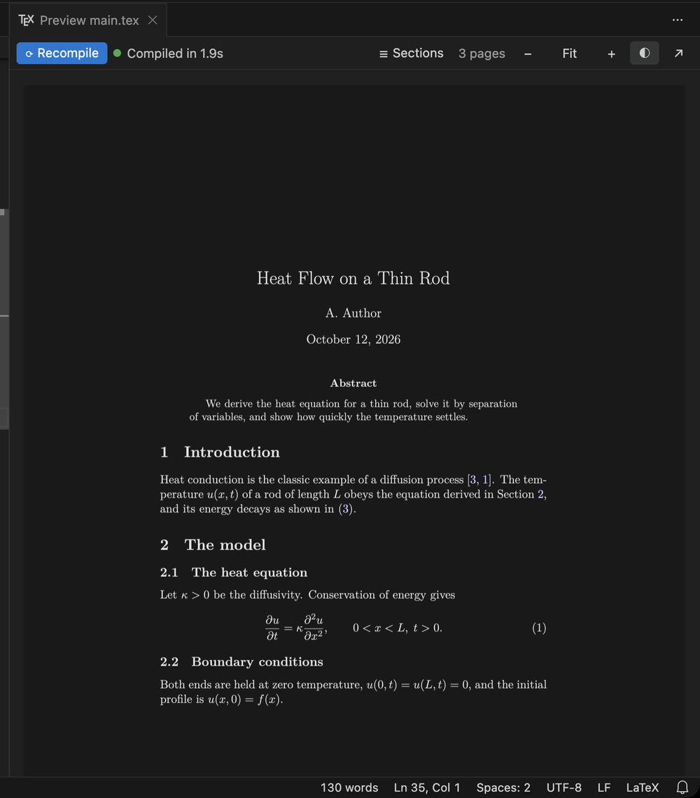 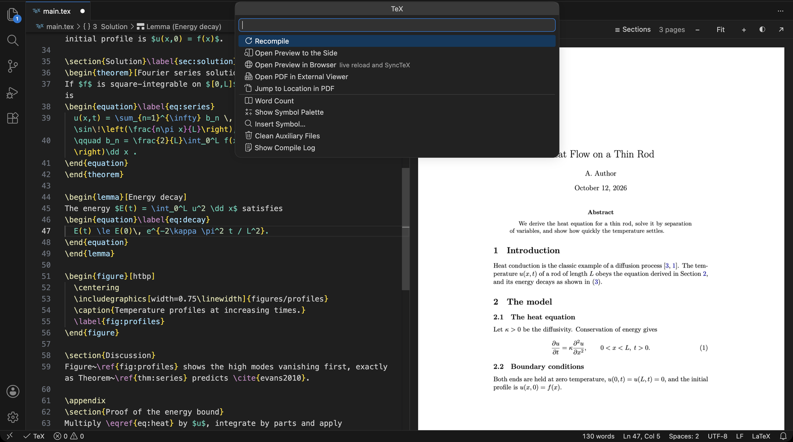

---

## Build options

| Need | How |
|---|---|
| Stop a long compile | **TeX: Stop Compiling** |
| Remove `.aux`, `.log`, `.synctex.gz` and similar files | **TeX: Clean Auxiliary Files**. The PDF is kept. |
| Use your own build | Set `texPreview.buildCommand`, e.g. `latexmk -pdf -outdir=%OUTDIR% %DOC%`. Errors and SyncTeX work as usual. |
| Build with no local TeX install | Set `texPreview.docker.image`, e.g. `texlive/texlive`. The compiler runs in that container. |
| Knitr or Weave documents | `.rnw` files are knitted with `Rscript` and `.jnw` files are woven with Julia before compiling. |
| Main file without a magic comment | Found automatically: a file without `\documentclass` is built through the file that `\input`s it. |
| Remote SSH, WSL, Dev Containers | The extension runs where your files are, so it uses the TeX installation there. |

---

## Supported files

| File | What you get |
|---|---|
| `.tex`, `.ltx` | Everything: preview, build, suggestions, hovers, Outline, folding, formatting, linting, editing commands. A file is built as the main document if it has `\documentclass`; otherwise through the file that includes it, or the one named in `% !TEX root = …`. |
| `.sty`, `.cls` | Suggestions, hovers, folding and formatting; saving rebuilds open previews. |
| `.bib` | Source of `\cite` suggestions and hovers; **Format Document** tidies entries; saving rebuilds. |
| `thebibliography` in a `.tex` file | `\bibitem` keys are suggested and previewed like `.bib` entries. |
| `.rnw` / `.Rnw` (knitr), `.jnw` (Weave.jl) | Woven to `.tex` and then built and previewed. |
| `.bst`, `.tikz` | Saving rebuilds open previews. |
| Images: `.pdf`, `.png`, `.jpg`, `.jpeg`, `.eps`, `.svg`, `.gif` | Suggested in `\includegraphics`, with a thumbnail on hover. `\graphicspath` is respected. |
| Included files | `\input`, `\include`, `\subfile`, `\import` / `\subimport` are followed for labels, citations, macros, numbering and word count. |
| `.texreview/*.jsonl` | Comments and tracked changes, one file per person; travels with the project. |
| Build output: `.pdf`, `.synctex.gz`, `.log`, `.aux` | PDF shown in the preview; SyncTeX for jumping; log parsed for errors; `.aux` read for reference numbers. All kept in `.texbuild/` by default. |

---

## Comments and tracked changes

Review a paper with co-authors the way you would on Overleaf: comment on a passage, suggest edits, and accept or reject them. Nothing is written into your `.tex` files. The PDF, Overleaf and every other tool see plain LaTeX.

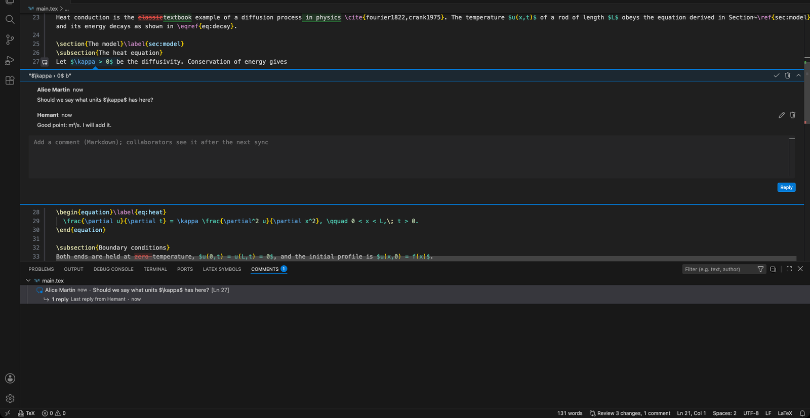

### Comments

Select some text and press **⌃L K** (Alt+L K on Windows/Linux), or click the **+** in the gutter. Type your comment (Markdown works) and click **Add Comment**. Each thread lets you:
- **reply**, and **edit** or **delete** your own comments (pencil and bin icons);
- **resolve** (✓) and reopen it, or delete the whole thread.

The **Comments** panel (bottom panel, next to Problems) lists every thread in the project; click one to jump to it. A comment is attached to the text it was made on, not to a line number. It follows that text as you and your co-authors edit around it. If the text itself is rewritten, the thread stays at its old line, marked *(text changed)*.

### Tracked changes

Press **⌃L R** (Alt+L R), or click **Review** in the status bar and choose **Track Changes**. While it's on, the status bar shows **● Tracking** and your edits become suggestions:

- **Inserted text** is highlighted in green.
- **Deleted text** stays visible, struck through in red. The file itself no longer contains it, so the PDF shows the proposed version.
- **Replacing a word** shows the new word highlighted with the old one struck through beside it.
- Typing a word letter by letter makes one suggestion, and backspacing over your own suggestion just shortens it.

Hover a suggestion to see who made it and when, with **Accept** and **Reject** links. **Accept** keeps the text; **Reject** puts the original back.

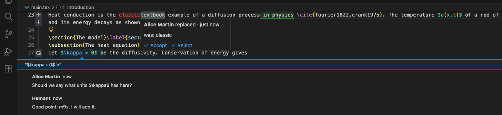

The same actions are in the lightbulb (⌘. / Ctrl+.) and on the right-click menu: **Accept Change** and **Reject Change** appear at the top when you right-click a suggestion, and **Add Comment** when text is selected.

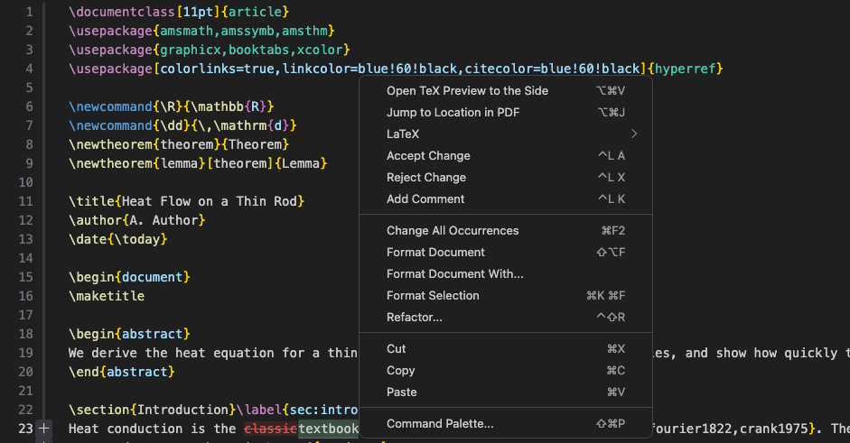

They're also on these keys:

| Action | macOS | Windows / Linux |
|---|---|---|
| Track changes on / off | ⌃L R | Alt+L R |
| Add a comment on the selection | ⌃L K | Alt+L K |
| Accept the change at the cursor (or in the selection) | ⌃L A | Alt+L A |
| Reject the change at the cursor (or in the selection) | ⌃L X | Alt+L X |
| Next / previous change | ⌃L ] / ⌃L [ | Alt+L ] / Alt+L [ |

Click **Review** in the status bar for the list of the file's suggestions (choose one to jump to it), **Accept All**, **Reject All**, and the comment actions.

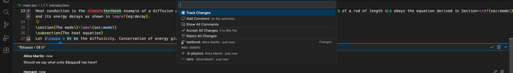

### Working with co-authors

- **Shared with the project:** review data is kept in a `.texreview/` folder at the top of the project, one small file per person. With [Overleaf sync](#overleaf-sync) it's pushed and pulled like any other file; in a Git repository you commit it with your work. Collaborators' comments and suggestions appear after the next sync.
- **No conflicts:** you only ever write to your own file, so two people reviewing at the same time can't produce a merge conflict in the review data.
- **Your name** comes from Git (`user.name`); set `texPreview.review.author` to use a different one.
- **Who sees what:** collaborators see comments and suggestions in VS Code with this extension. People editing on overleaf.com see the current text, but not the comments or suggestions; Overleaf offers no way for other tools to add to its review panel.
- **Tracking is personal:** turning Track Changes on affects your own edits only. Edits pulled from Overleaf, and edits made while tracking is off, are never recorded as suggestions.

---

## Overleaf sync

TeX Side Preview can keep a local folder and an Overleaf project in sync **in both directions**, with no manual pull or push. It uses Overleaf's official Git integration, which needs an Overleaf plan that includes Git (premium or institutional).

### Setting it up

1. On overleaf.com, open **Account Settings → Git Integration** and click **Create token**.
2. In VS Code, run **Overleaf: Clone Project…** from the Command Palette (⇧⌘P):

   

3. Paste the project's URL from your browser, then your token. The token is asked for only once. Then choose a folder:

   

4. Open the cloned folder. From now on everything syncs automatically.

A folder you cloned yourself with `git clone https://git.overleaf.com/<project-id>` is detected and synced as well.

### How syncing works

| When | What happens |
|---|---|
| You save a file | It's committed and pushed to Overleaf about 2 seconds later, so quick successive saves become one commit. Creating, deleting and renaming files in the Explorer also sync. |
| Someone edits on Overleaf | The change is pulled within a minute, or right away when the VS Code window regains focus. Open editors update and the preview recompiles. |
| You have unsaved edits in a file Overleaf changed | The pull waits until you save, so nothing changes under your cursor. |
| Both sides changed the same lines | You resolve the conflict in VS Code (see below). Conflict markers are never pushed to Overleaf. |

Below, a collaborator's sentence ("Stochastic variants are left for future work.") arrived from Overleaf; the editor and the PDF both updated, and the sync log shows the pull:


### Status bar and actions

The **Overleaf** item in the status bar shows the sync state: synced, syncing, waiting, *conflict* or an error. Hover it for details:


Click it for **Sync Now**, **Pause/Resume Auto-Sync**, **Open Project on Overleaf**, **Set Overleaf Git Token…** and **Show Sync Log**:


### Resolving conflicts

If you and a collaborator change the same line, the status bar turns to **⚠ Overleaf: conflict** and a notification explains what happened. The file shows the two versions with VS Code's usual **Accept Current / Accept Incoming / Accept Both** buttons. Pick one (or edit by hand) and save. The merge is then pushed and syncing continues.


### Privacy and safety

- **The token** is stored in VS Code's encrypted secret storage. It's passed to git only through environment variables, so it's never written into `.git/config` or shown on a command line, and it's only sent to `git.overleaf.com`.
- **Build output** (`.texbuild/`) is excluded through `.git/info/exclude`, so it never reaches Overleaf, and none of your project's files are changed to arrange that.
- **Git never prompts.** It's run non-interactively, so a bad or expired token produces a clear "Set Token" message rather than a hanging password prompt.

---

## Commands and keyboard shortcuts

Every command is in the Command Palette (⇧⌘P / Ctrl+Shift+P) under **TeX:** or **Overleaf:**. On macOS the editing keys are ⌃L then a key; on Windows/Linux, Alt+L then a key.

**Preview and build**

| Command | macOS | Windows / Linux | Also in |
|---|---|---|---|
| **TeX: Open TeX Preview to the Side** | ⌥⌘V | Ctrl+Alt+V | Title-bar button; Explorer, editor and tab right-click menus |
| **TeX: Recompile** (saves first) | ⌘↵ | Ctrl+Enter | *Recompile* button in the preview |
| **TeX: Jump to Location in PDF** | ⌥⌘J | Ctrl+Alt+J | Editor right-click menu |
| **TeX: Open Preview in Browser** | | | ↗ in the preview; title-bar `···` menu; LaTeX right-click submenu |
| **TeX: Open PDF in External Viewer** | | | LaTeX right-click submenu |
| **TeX: Stop Compiling** | | | TeX status bar menu |
| **TeX: Clean Auxiliary Files** | | | LaTeX right-click submenu |
| **TeX: Show Compile Log** | | | TeX status bar menu |
| **TeX: TeX Actions…** | | | Click **TeX** in the status bar |

**Editing**

| Command | macOS | Windows / Linux |
|---|---|---|
| **TeX: Bold** / **Italic** / **Emphasis** / **Typewriter** / **Underline** | ⌃L B / I / E / T / U | Alt+L B / I / E / T / U |
| **TeX: Small Caps** / **Footnote** | ⌃L S / F | Alt+L S / F |
| **TeX: Inline Math $…$** | ⌃L 4 | Alt+L 4 |
| **TeX: Surround with Command…** | ⌃L W | Alt+L W |
| **TeX: Surround with Environment…** | ⌃L N | Alt+L N |
| **TeX: Close Current Environment** | ⌃L C | Alt+L C |
| **TeX: Toggle `\[ \]` and `equation*`** | ⌃L M | Alt+L M |
| **TeX: Toggle Star (numbered / unnumbered)** | ⌃L 8 | Alt+L 8 |
| **TeX: Promote Heading** / **Demote Heading** | ⌃L ↑ / ↓ | Alt+L ↑ / ↓ |
| **TeX: Go to Matching \begin / \end** | ⌃L J | Alt+L J |
| **TeX: Insert Symbol…** | ⌃L . | Alt+L . |
| **TeX: Show Symbol Palette** (also the operator icon in the editor title bar) | ⌃L P | Alt+L P |
| **TeX: Count Words** | ⌃L ⌃C | Alt+L Alt+C |
| **TeX Review: Toggle Track Changes** | ⌃L R | Alt+L R |
| Add comment (**Comments: Add Comment on Current Selection**) | ⌃L K | Alt+L K |
| **TeX Review: Accept Change** / **Reject Change** | ⌃L A / ⌃L X | Alt+L A / Alt+L X |
| **TeX Review: Next Change** / **Previous Change** | ⌃L ] / ⌃L [ | Alt+L ] / Alt+L [ |
| **TeX Review: Accept All Changes in File** / **Reject All…** | | |
| **TeX Review: Review…** (also **Review** in the status bar) | | |
| End list (Enter on an empty `\item`) | ↵ | Enter |

**VS Code's own keys, powered by the extension**

| Action | macOS | Windows / Linux |
|---|---|---|
| Suggestions | ⌃Space | Ctrl+Space |
| Go to Symbol (headings, figures, theorems) | ⇧⌘O | Ctrl+Shift+O |
| Expand / shrink selection | ⌃⇧⌘→ / ← | Shift+Alt+→ / ← |
| Format Document | ⇧⌥F | Shift+Alt+F |
| Fold / unfold | ⌥⌘[ / ] | Ctrl+Shift+[ / ] |
| Show hover | ⌘K ⌘I | Ctrl+K Ctrl+I |

**Overleaf**

| Command | Where |
|---|---|
| **Overleaf: Clone Project…** | Command Palette |
| **Overleaf: Sync Now** | Overleaf status bar menu |
| **Overleaf: Sync Actions…** | Click **Overleaf** in the status bar |
| **Overleaf: Set Git Token…** | Overleaf status bar menu |

**In the PDF** (panel or browser): **double-click** jumps to the source, **⌘C** copies the selection, **⌘/Ctrl + mouse wheel** zooms, and **☰ Sections** jumps to a heading.

---

## Settings

| Setting | Default | Description |
|---|---|---|
| `texPreview.engine` | `auto` | `auto`, `latexmk`, `tectonic`, `pdflatex`, `xelatex` or `lualatex`. `auto` uses the first of latexmk, tectonic and pdflatex that's installed. |
| `texPreview.latexmkEngine` | `pdf` | What latexmk runs: `pdf`, `xelatex` or `lualatex`. |
| `texPreview.outDir` | `.texbuild` | Where the PDF and auxiliary files go, relative to the main `.tex` file. Use `.` to build next to the source. |
| `texPreview.compileOnSave` | `true` | Recompile when a `.tex`/`.bib`/`.sty`/`.cls` file is saved. |
| `texPreview.extraPath` | `[]` | Extra folders to search for TeX programs. |
| `texPreview.buildCommand` | `""` | A shell command that replaces the built-in build. Placeholders: `%DOC%`, `%DOCFILE%`, `%TEX%`, `%DIR%`, `%OUTDIR%`. |
| `texPreview.docker.image` | `""` | Run the compiler inside this Docker image. |
| `texPreview.invertPdf` | `never` | `never`, `darkTheme` or `always`: show the PDF with dark pages. |
| `texPreview.chktex` | `false` | Lint `.tex` files with ChkTeX as you type. |
| `texPreview.externalViewer.command` | `""` | Command that opens the PDF externally (`%PDF%`). Empty uses the system default. |
| `texPreview.externalViewer.syncCommand` | `""` | Forward search in the external viewer (`%PDF%`, `%TEX%`, `%LINE%`). |
| `texPreview.review.author` | `""` | Your name on comments and tracked changes. Empty uses Git's `user.name`. |
| `texPreview.overleaf.autoSync` | `true` | Two-way sync for folders cloned from Overleaf. |
| `texPreview.overleaf.pullInterval` | `60` | Seconds between checks for changes on Overleaf (minimum 15). |
| `texPreview.overleaf.pushDelay` | `2` | Seconds after a save before pushing. |

---

## Troubleshooting

**"No LaTeX compiler found."** Install one of the compilers listed under [Installation](#1-install-a-latex-compiler) and click **Recompile**. If it's installed somewhere unusual, add its folder to `texPreview.extraPath`.

**The first compile with tectonic is slow.** Tectonic downloads the packages your document uses the first time; later compiles take seconds.

**A missing image or `.bib` file stops the build.** Check that every file the document references is in the project folder. Click the error above the PDF to go to the line that references it.

**Overleaf says the token was rejected.** Create a new token on overleaf.com and run **Overleaf: Set Git Token…**. Overleaf's Git integration requires a plan that includes it.

**Something else.** **TeX: Show Compile Log** and the Overleaf menu's **Show Sync Log** show exactly what was run.

---

## Building from source

```sh
npm install
npm run package          # → tex-side-preview-<version>.vsix
code --install-extension tex-side-preview-<version>.vsix
```

Or open this folder in VS Code and press **F5** to start an Extension Development Host.

| File | Purpose |
|---|---|
| `extension.js` | Commands, compiling, log parsing, the preview panel |
| `project.js` | Finds the main file and reads labels, citations and macros across the project |
| `language.js`, `data.js`, `symbols.js` | Suggestions and hover previews; the built-in command list and the symbol catalogue |
| `palette.js` | The Symbols panel and **Insert Symbol…** |
| `server.js` | Serves the live preview to a web browser |
| `review.js` | Comments and tracked changes: the per-person logs, text anchors, decorations and comment threads |
| `math.js` | Finds math in a document and renders it with MathJax for hovers |
| `structure.js` | Outline, folding, Expand Selection, linked `\begin`/`\end`, word count |
| `editing.js` | Editing commands, `\item` lists, the word count, formatting, duplicate-label and ChkTeX diagnostics |
| `tools.js` | Finding and running external programs |
| `synctex.js` | SyncTeX reader (PDF ↔ source positions) |
| `overleaf.js` | Two-way Overleaf sync over Git |
| `media/viewer.js`, `media/viewer.css` | The PDF viewer inside the preview (pdf.js, text layer, links) |
