# TeX Side Preview

**Overleaf-style LaTeX editing inside VS Code.** Your source is on the left and the PDF on the right. Save the file and the PDF re-renders in place. Double-click the PDF to jump to the source, links work, text can be copied, and the project can sync both ways with Overleaf.

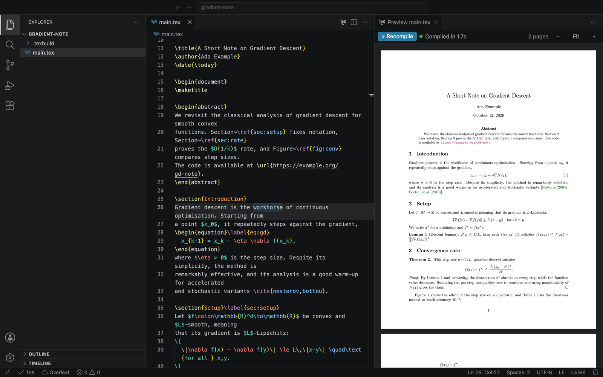

**Contents**

- [Features at a glance](#features-at-a-glance)
- [Installation](#installation)
- [Opening the preview](#opening-the-preview)
- [Features](#features)
  - [Live preview on save](#live-preview-on-save)
  - [Errors and warnings](#errors-and-warnings)
  - [PDF → source: double-click to jump](#pdf--source-double-click-to-jump)
  - [Source → PDF: jump to location](#source--pdf-jump-to-location)
  - [Clickable links](#clickable-links)
  - [Selecting and copying text](#selecting-and-copying-text)
  - [Zoom](#zoom)
  - [Multi-file projects](#multi-file-projects)
- [Overleaf sync](#overleaf-sync)
- [Commands and keyboard shortcuts](#commands-and-keyboard-shortcuts)
- [Settings](#settings)
- [Troubleshooting](#troubleshooting)
- [Building from source](#building-from-source)

---

## Features at a glance

| | |
|---|---|
| 🖥️ **Side-by-side preview** | The PDF opens next to your source, the way Overleaf shows it. |
| 💾 **Recompile on save** | Press ⌘S and the PDF refreshes, keeping your scroll position. |
| 🧭 **SyncTeX, both directions** | Double-click the PDF to jump to the source line, or press ⌘⌥J to jump from the source into the PDF. |
| 🔗 **Working links** | `\ref`, `\cite`, contents and footnote links scroll inside the PDF; URLs open in your browser. |
| ✂️ **Select and copy** | Drag across text in the PDF and press ⌘C. |
| 🚨 **Clickable errors** | Errors are listed above the PDF and in the Problems panel; the last good PDF stays visible. |
| ☁️ **Two-way Overleaf sync** | Saves are pushed, Overleaf changes are pulled, and conflicts open in VS Code's merge editor. |

---

## Installation

### 1. Install a LaTeX compiler

The extension runs your local LaTeX installation and uses the first compiler it finds:

| Compiler | Install on macOS | Notes |
|---|---|---|
| `latexmk` | `brew install --cask mactex-no-gui` | Full TeX Live. The fastest choice for repeated builds; handles BibTeX/Biber. |
| `tectonic` | `brew install tectonic` | A small single binary that downloads packages on first use (the first compile takes a few minutes, later ones a few seconds). |
| `pdflatex` | comes with TeX Live / MiKTeX | Fallback. Runs BibTeX and reruns as needed. |

On Linux, `sudo apt install texlive-full latexmk` works. On Windows, install MiKTeX or TeX Live. The extension also looks in the usual install folders (`/Library/TeX/texbin`, `/opt/homebrew/bin`, `/usr/local/texlive/*/bin/*`, …), so it works even when VS Code is started from the Dock.

### 2. Install the extension

The extension ships as a `.vsix` file. In VS Code, open the **Extensions** view (⇧⌘X), click the **`···`** menu at the top of the view and choose **Install from VSIX…**, then pick `tex-side-preview-<version>.vsix`.

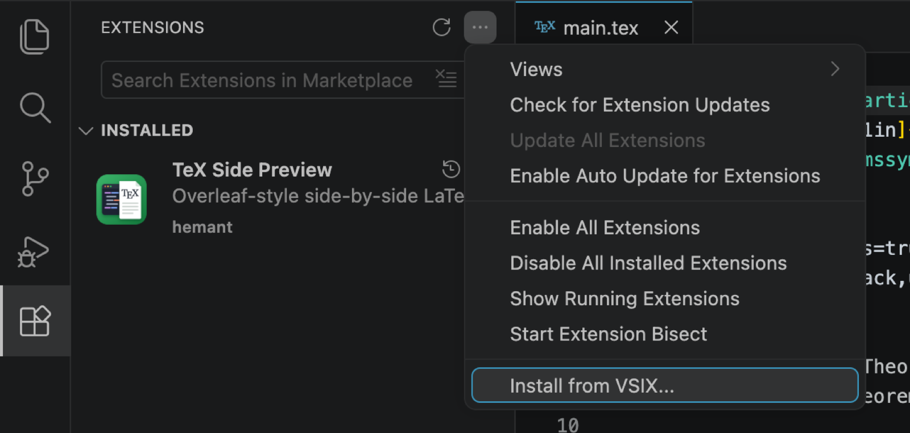

From the command line:

```sh
code --install-extension tex-side-preview-0.4.1.vsix
```

Once it's installed, search for **TeX Side Preview** in the Extensions view to see it, or type `@installed tex` to filter:

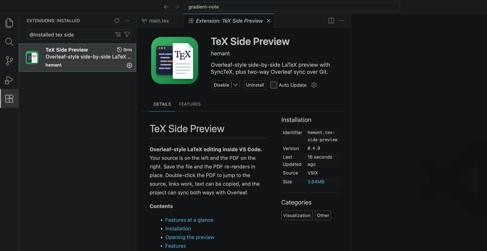

---

## Opening the preview

Open any `.tex` file, then use whichever way suits you.

**Editor title bar.** Click the **T<sub>E</sub>X** button at the top right of the editor, next to *Split Editor*:

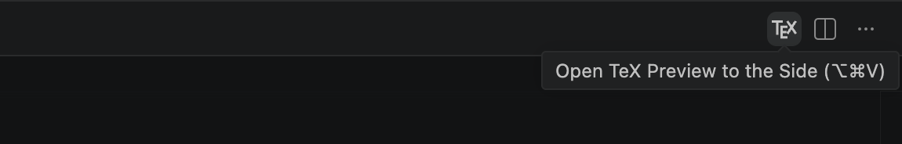

**Right-click the file in the Explorer.** Choose **Open TeX Preview to the Side**:

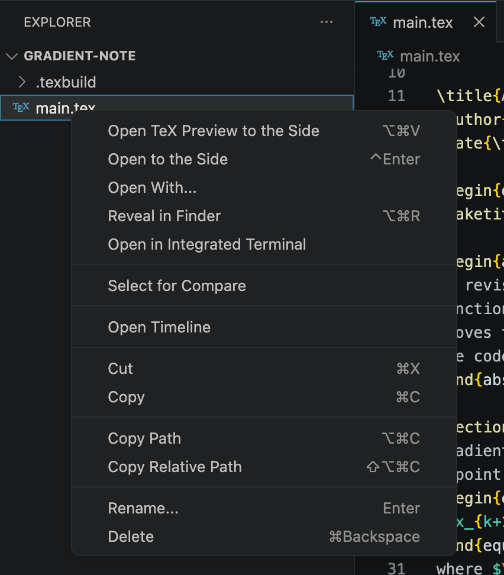

**Right-click inside the editor.** The menu offers **Open TeX Preview to the Side** and **Jump to Location in PDF**:

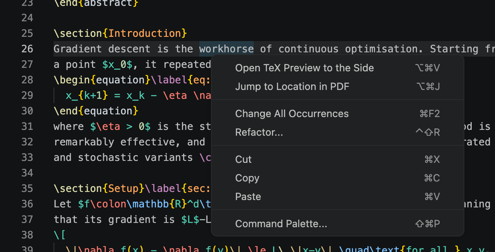

**Right-click the editor tab.** Choose **Open TeX Preview to the Side**:

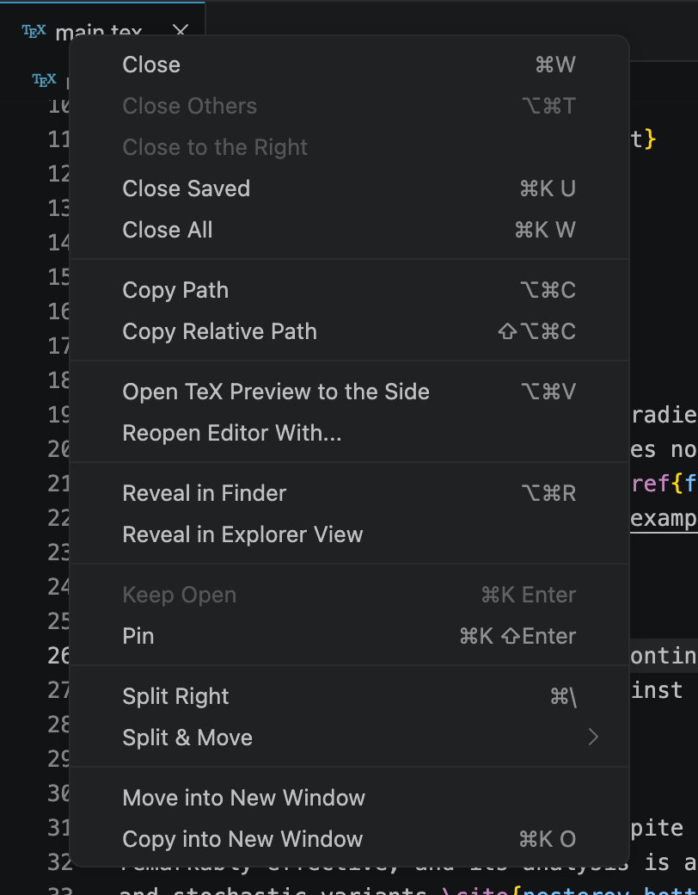

**Keyboard.** Press **⌥⌘V** (Ctrl+Alt+V on Windows/Linux), or run **TeX: Open TeX Preview to the Side** from the Command Palette.

---

## Features

### Live preview on save

Edit, press **⌘S**, and the PDF recompiles and refreshes in place without losing your scroll position. **⌘↵** (Ctrl+Enter) saves and recompiles in one step, and the **Recompile** button in the preview does the same. The status line shows how long the compile took and how many warnings it produced. The status bar shows the state too: **✓ TeX**, a spinner while compiling, or **TeX: errors**.

Saving any `.tex`, `.bib`, `.sty` or `.cls` file in the project triggers a recompile.

### Errors and warnings

If a compile fails, the errors are listed above the PDF. **Click one to jump to that line.** The preview keeps showing the last good PDF until the error is fixed. Errors and warnings also appear in the **Problems** panel and as squiggles in the editor. **Show full log** opens the complete compiler output.

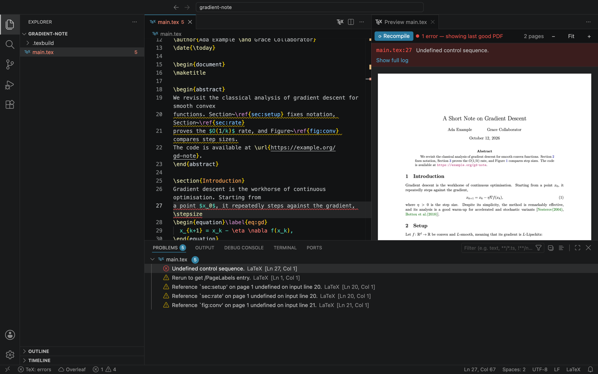

### PDF → source: double-click to jump

**Double-click any word in the PDF.** The editor jumps to the line that produced it and selects that word, the same as Overleaf. This uses SyncTeX, so it works for paragraphs, headings, captions and math.

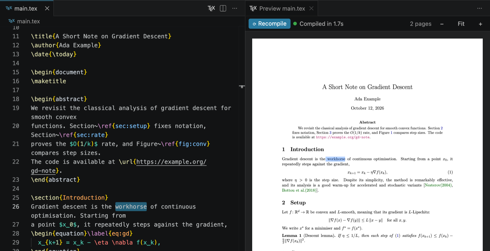

### Source → PDF: jump to location

Put the cursor on a line and press **⌥⌘J** (Ctrl+Alt+J), or right-click → **Jump to Location in PDF**. The preview scrolls to that spot and then highlights the typeset line for a couple of seconds:

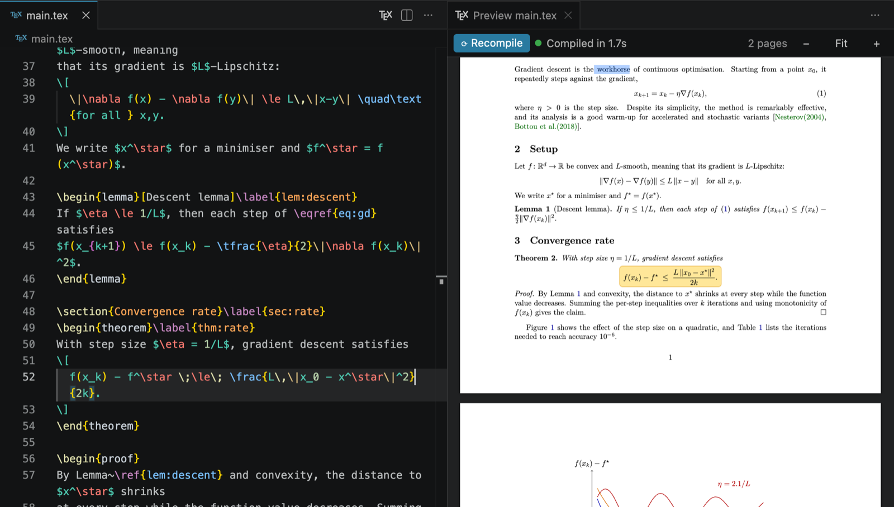

### Clickable links

Hyperlinks in the PDF work like in a PDF viewer. `\ref`, `\eqref`, `\cite`, table-of-contents and footnote links scroll to their target inside the preview, and `\url`/`\href` links open in your browser. Hovering a link outlines it.

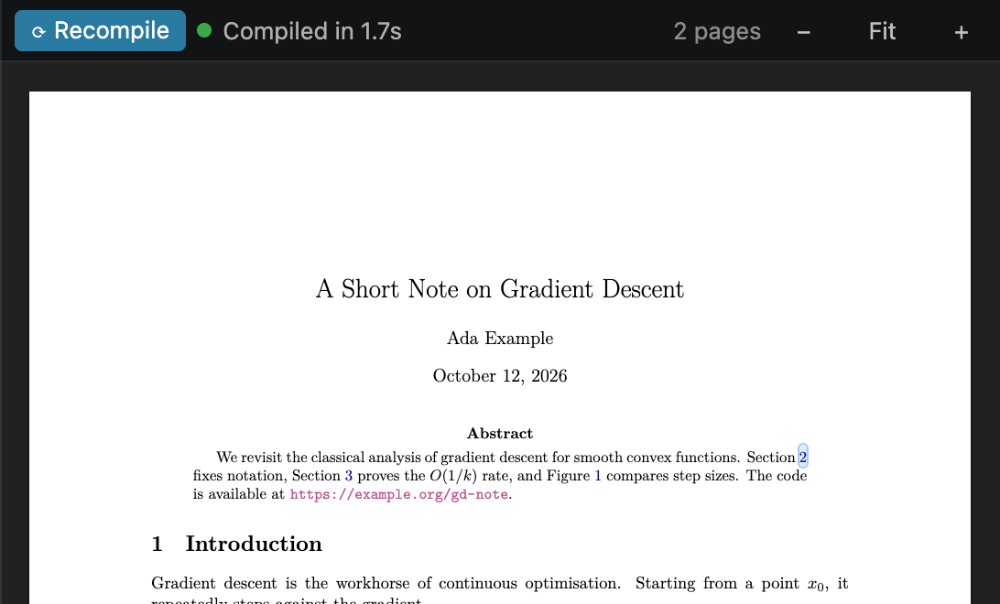

### Selecting and copying text

Drag across text in the PDF to select it, then press **⌘C** (Ctrl+C) to copy it, line breaks included.

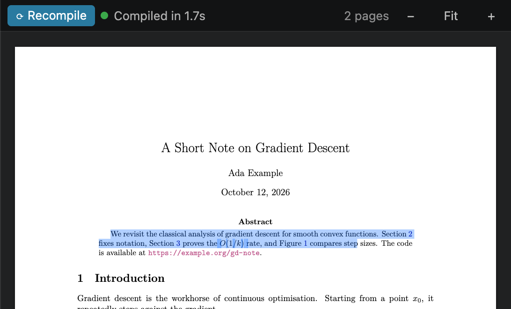

### Zoom

Use **−** and **+** in the preview's toolbar, or hold ⌘/Ctrl and scroll the mouse wheel. **Fit** (or the percentage label) fits the page to the panel width and follows the panel as you resize it.

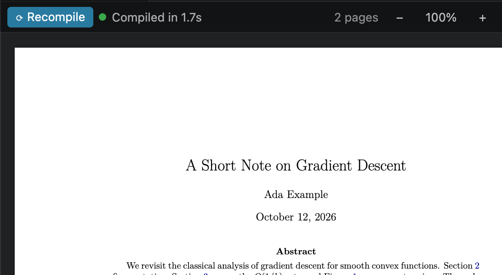

### Multi-file projects

For projects split across files with `\input` or `\include`, add a magic comment at the top of each included file pointing to the main file:

```latex
% !TEX root = ../main.tex
```

Opening the preview from any of those files then shows the main document, and saving any file in the project recompiles it.

---

## Overleaf sync

TeX Side Preview can keep a local folder and an Overleaf project in sync **in both directions**, with no manual pull or push. It uses Overleaf's official Git integration, which needs an Overleaf plan that includes Git (premium or institutional).

### Setting it up

1. On overleaf.com, open **Account Settings → Git Integration** and click **Create token**.
2. In VS Code, run **Overleaf: Clone Project…** from the Command Palette (⇧⌘P):

   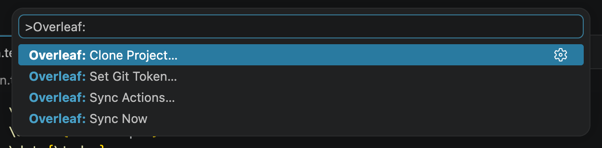

3. Paste the project's URL from your browser, then your token. The token is asked for only once. Then choose a folder:

   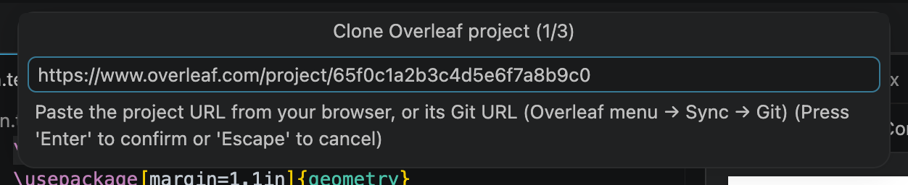

4. Open the cloned folder. From now on everything syncs automatically.

A folder you cloned yourself with `git clone https://git.overleaf.com/<project-id>` is detected and synced as well.

### How syncing works

| When | What happens |
|---|---|
| You save a file | It's committed and pushed to Overleaf about 2 seconds later, so quick successive saves become one commit. Creating, deleting and renaming files in the Explorer also sync. |
| Someone edits on Overleaf | The change is pulled within a minute, or right away when the VS Code window regains focus. Open editors update and the preview recompiles. |
| You have unsaved edits in a file Overleaf changed | The pull waits until you save, so nothing changes under your cursor. |
| Both sides changed the same lines | You resolve the conflict in VS Code (see below). Conflict markers are never pushed to Overleaf. |

Below, a collaborator's sentence ("Stochastic variants are left for future work.") arrived from Overleaf; the editor and the PDF both updated, and the sync log shows the pull:

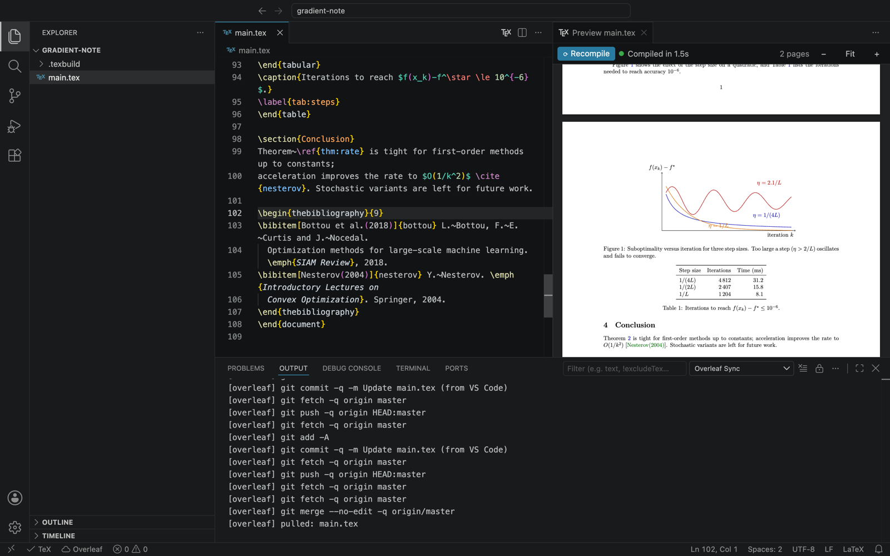

### Status bar and actions

The **Overleaf** item in the status bar shows the sync state: synced, syncing, waiting, *conflict* or an error. Hover it for details:

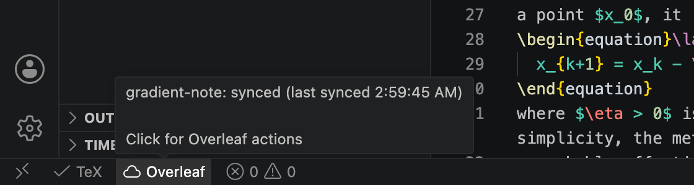

Click it for **Sync Now**, **Pause/Resume Auto-Sync**, **Open Project on Overleaf**, **Set Overleaf Git Token…** and **Show Sync Log**:

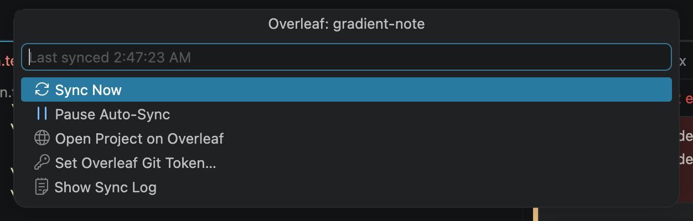

### Resolving conflicts

If you and a collaborator change the same line, the status bar turns to **⚠ Overleaf: conflict** and a notification explains what happened. The file shows the two versions with VS Code's usual **Accept Current / Accept Incoming / Accept Both** buttons. Pick one (or edit by hand) and save. The merge is then pushed and syncing continues.

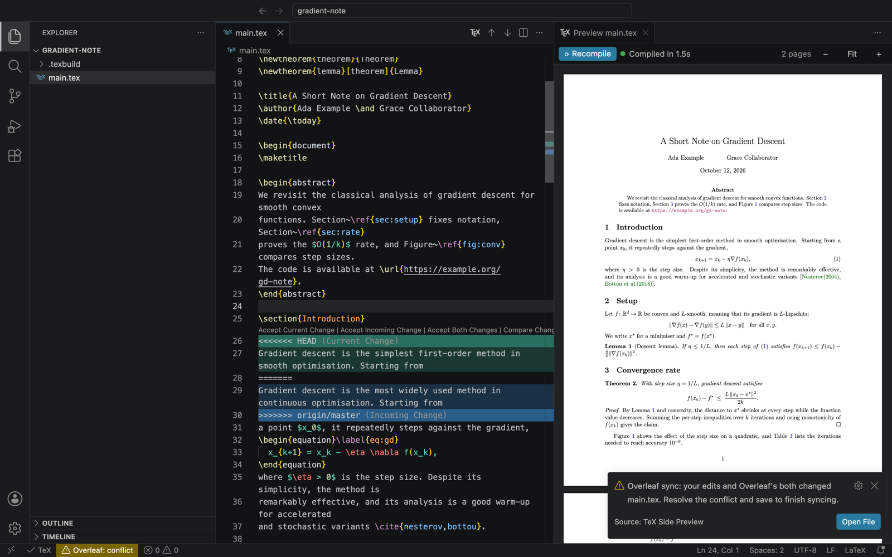

### Privacy and safety

- **The token** is stored in VS Code's encrypted secret storage. It's passed to git only through environment variables, so it's never written into `.git/config` or shown on a command line, and it's only sent to `git.overleaf.com`.
- **Build output** (`.texbuild/`) is excluded through `.git/info/exclude`, so it never reaches Overleaf, and none of your project's files are changed to arrange that.
- **Git never prompts.** It's run non-interactively, so a bad or expired token produces a clear "Set Token" message rather than a hanging password prompt.

---

## Commands and keyboard shortcuts

| Command | macOS | Windows / Linux | Where else |
|---|---|---|---|
| **TeX: Open TeX Preview to the Side** | ⌥⌘V | Ctrl+Alt+V | Title-bar button; Explorer, editor and tab right-click menus |
| **TeX: Jump to Location in PDF** | ⌥⌘J | Ctrl+Alt+J | Editor right-click menu |
| **TeX: Recompile** (saves first) | ⌘↵ | Ctrl+Enter | *Recompile* button in the preview |
| **TeX: Show Compile Log** | | | Click **TeX** in the status bar |
| **Overleaf: Clone Project…** | | | |
| **Overleaf: Sync Now** | | | Overleaf status bar menu |
| **Overleaf: Sync Actions…** | | | Click **Overleaf** in the status bar |
| **Overleaf: Set Git Token…** | | | Overleaf status bar menu |

In the PDF: **double-click** jumps to the source, **⌘C** copies the selection, and **⌘/Ctrl + mouse wheel** zooms.

---

## Settings

| Setting | Default | Description |
|---|---|---|
| `texPreview.engine` | `auto` | `auto`, `latexmk`, `tectonic`, `pdflatex`, `xelatex` or `lualatex`. `auto` uses the first of latexmk, tectonic and pdflatex that's installed. |
| `texPreview.latexmkEngine` | `pdf` | What latexmk runs: `pdf`, `xelatex` or `lualatex`. |
| `texPreview.outDir` | `.texbuild` | Where the PDF and auxiliary files go, relative to the main `.tex` file. Use `.` to build next to the source. |
| `texPreview.compileOnSave` | `true` | Recompile when a `.tex`/`.bib`/`.sty`/`.cls` file is saved. |
| `texPreview.extraPath` | `[]` | Extra folders to search for TeX programs. |
| `texPreview.overleaf.autoSync` | `true` | Two-way sync for folders cloned from Overleaf. |
| `texPreview.overleaf.pullInterval` | `60` | Seconds between checks for changes on Overleaf (minimum 15). |
| `texPreview.overleaf.pushDelay` | `2` | Seconds after a save before pushing. |

---

## Troubleshooting

**"No LaTeX compiler found."** Install one of the compilers listed under [Installation](#1-install-a-latex-compiler) and click **Recompile**. If it's installed somewhere unusual, add its folder to `texPreview.extraPath`.

**The first compile with tectonic is slow.** Tectonic downloads the packages your document uses the first time; later compiles take seconds.

**A missing image or `.bib` file stops the build.** Check that every file the document references is in the project folder. Click the error above the PDF to go to the line that references it.

**Overleaf says the token was rejected.** Create a new token on overleaf.com and run **Overleaf: Set Git Token…**. Overleaf's Git integration requires a plan that includes it.

**Something else.** **TeX: Show Compile Log** and the Overleaf menu's **Show Sync Log** show exactly what was run.

---

## Building from source

```sh
npm install
npm run package          # → tex-side-preview-<version>.vsix
code --install-extension tex-side-preview-<version>.vsix
```

Or open this folder in VS Code and press **F5** to start an Extension Development Host.

| File | Purpose |
|---|---|
| `extension.js` | Commands, compiling, log parsing, the preview panel |
| `synctex.js` | SyncTeX reader (PDF ↔ source positions) |
| `overleaf.js` | Two-way Overleaf sync over Git |
| `media/viewer.js`, `media/viewer.css` | The PDF viewer inside the preview (pdf.js, text layer, links) |
